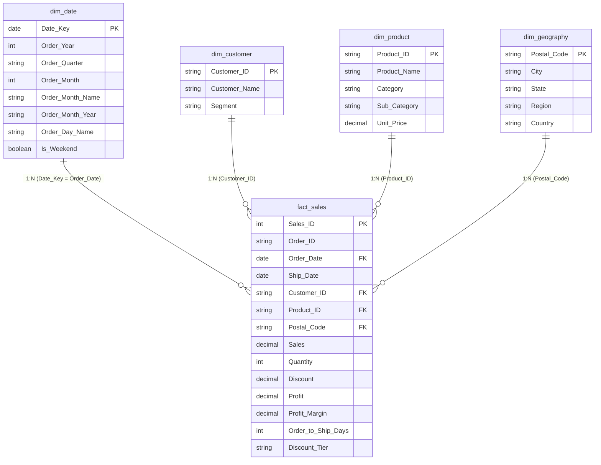

# Power BI Data Model Architecture & Semantic Design

## 1. Dimensional Model Overview (Star Schema)

The analytical data model follows Ralph Kimball's **Star Schema** architecture, optimized for high-performance Power BI VertiPaq engine querying. A central transactional fact table (`fact_sales`) connects outward to four distinct dimension tables with **1-to-Many (`1:*`)** relationships and **Single cross-filter direction**.



---

## 2. Table Relationships & Cardinality Configuration

| From Table (Dimension) | Primary Key | To Table (Fact) | Foreign Key | Cardinality | Cross-Filter Direction | Security Filtering |
| :--- | :--- | :--- | :--- | :--- | :--- | :--- |
| `dim_date` | `Date_Key` | `fact_sales` | `Order_Date` | `1 : *` (One to Many) | Single | None |
| `dim_customer` | `Customer_ID` | `fact_sales` | `Customer_ID` | `1 : *` (One to Many) | Single | None |
| `dim_product` | `Product_ID` | `fact_sales` | `Product_ID` | `1 : *` (One to Many) | Single | None |
| `dim_geography` | `Postal_Code` | `fact_sales` | `Postal_Code` | `1 : *` (One to Many) | Single | None |

> [!IMPORTANT]
> **Best Practice**: Always set Cross-filter direction to **Single** to maintain query predictability, prevent circular relationship loops, and maximize VertiPaq column compression.

---

## 3. Dedicated Calendar Date Table DAX Formulation

In Power BI Desktop, navigate to **Modeling > New Table** and execute the following DAX formula:

```dax
dim_date = 
VAR MinDate = DATE(2023, 1, 1)
VAR MaxDate = DATE(2026, 12, 31)
RETURN
    ADDCOLUMNS(
        CALENDAR(MinDate, MaxDate),
        "Date_Key", [Date],
        "Order_Year", YEAR([Date]),
        "Order_Quarter", "Q" & FORMAT([Date], "Q"),
        "Order_Month", MONTH([Date]),
        "Order_Month_Name", FORMAT([Date], "mmm"),
        "Order_Month_Year", FORMAT([Date], "yyyy-mm"),
        "Order_Day_Name", FORMAT([Date], "dddd"),
        "Day_Of_Week", WEEKDAY([Date], 2),
        "Is_Weekend", IF(WEEKDAY([Date], 2) IN {6, 7}, TRUE(), FALSE())
    )
```

**Sort Order Setting**:
- Select `Order_Month_Name` in the Fields list -> Click **Sort by Column** -> Choose `Order_Month`.
- Select `Order_Month_Year` -> Click **Sort by Column** -> Choose `Date_Key`.

---

## 4. Power Query (M) ETL Ingestion Script

If connecting directly to `data/processed/retail_sales_clean.csv`, the Power Query transformation code is:

```powerquery
let
    Source = Csv.Document(File.Contents("C:\Users\Akshatha\OneDrive\Desktop\TIC TAC\retail_sales_analytics\data\processed\retail_sales_clean.csv"),[Delimiter=",", Columns=31, Encoding=65001, QuoteStyle=QuoteStyle.None]),
    #"Promoted Headers" = Table.PromoteHeaders(Source, [PromoteAllScalars=true]),
    #"Changed Type" = Table.TransformColumnTypes(#"Promoted Headers",{
        {"Order_ID", type text},
        {"Order_Date", type date},
        {"Ship_Date", type date},
        {"Ship_Mode", type text},
        {"Customer_ID", type text},
        {"Customer_Name", type text},
        {"Segment", type text},
        {"Country", type text},
        {"City", type text},
        {"State", type text},
        {"Postal_Code", type text},
        {"Region", type text},
        {"Product_ID", type text},
        {"Category", type text},
        {"Sub_Category", type text},
        {"Product_Name", type text},
        {"Sales", Currency.Type},
        {"Quantity", Int64.Type},
        {"Discount", Percentage.Type},
        {"Profit", Currency.Type},
        {"Profit_Margin", Percentage.Type},
        {"Unit_Price", Currency.Type},
        {"Order_Year", Int64.Type},
        {"Order_to_Ship_Days", Int64.Type},
        {"Discount_Tier", type text},
        {"Is_Profitable", type logical}
    })
in
    #"Changed Type"
```
