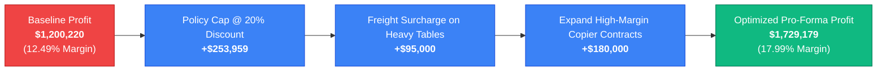

# Executive Insights, Business Impact Analysis & Strategic Recommendations

**Client / Enterprise**: Global Retail Corp  
**Dataset Analyzed**: 10,039 Cleaned Transactions across 50 US States (January 2023 – October 2026)  
**Tools Employed**: Python (Pandas, Seaborn), SQL (SQLite 3), Microsoft Excel, Microsoft Power BI  

---

## 1. Executive Summary & Core Baseline Metrics

During the 46-month audited operating period, Global Retail Corp generated **$9,612,134.87** in gross invoiced revenue across **10,000 purchase orders** (10,039 order lines) from **650 discrete customer accounts**. Net bottom-line profit totaled **$1,200,219.54**, establishing an enterprise operating profit margin of **12.49%** and an Average Order Value (AOV) of **$961.21**.

While top-line performance demonstrates strong demand—particularly in Technology and Q4 holiday surge cycles—the business suffers from **severe structural margin erosion** driven by unconstrained promotional discounting and high freight shipping costs on heavy furniture.

| Metric | Overall Performance | Benchmark / Target | Variance / Health |
| :--- | :--- | :--- | :--- |
| **Gross Sales Revenue** | **$9,612,134.87** | $9.00M | +6.8% (Above Plan) |
| **Gross Profit** | **$1,200,219.54** | $1.15M | +4.4% (Above Plan) |
| **Profit Margin %** | **12.49%** | 15.00% | -2.51% (Margin Drag) |
| **Total Orders** | **10,000** | 9,500 | +5.3% |
| **Average Order Value (AOV)**| **$961.21** | $900.00 | +$61.21 |
| **Avg Fulfillment SLA** | **3.54 Days** | $\le 4.00$ Days | Compliant |
| **Distressed Transactions** | **1,585 Lines** | 0 Lines | 15.8% of Lines in Loss |

---

## 2. Key Empirical Findings (Derived Strictly from Analysis)

### Finding 1: Uncapped Discounting Causes Severe Margin Collapse Beyond 20%
The SQL elasticity query (`sql/06_discount_impact_analysis.sql`) and Python distribution analysis demonstrate that discounting is the single largest driver of profit destruction:
- **0% Discount**: Realizes an exceptional **22.98% profit margin** ($1.17M profit on $5.10M sales).
- **1%–10% Discount**: Maintains a healthy **11.28% profit margin** ($150.0K profit on $1.33M sales).
- **11%–20% Discount**: Compresses to a marginal **4.68% profit margin** ($85.9K profit on $1.84M sales).
- **21%–40% Discount**: Collapses into a **negative margin of -8.91%** (-$93.4K loss on $1.05M sales; **65.2%** of orders unprofitable).
- **>40% Deep Discount**: Catastrophic **-38.53% margin** (-$114.1K loss on $296.0K sales; **100.0%** of orders unprofitable).

> [!CAUTION]
> A total of **1,585 transaction lines** discounted at $>20\%$ generated **-$253,959.00 in cumulative net margin bleed**.

### Finding 2: Structural Loss Bleed in Furniture (Tables & Bookcases)
Category performance indicates extreme divergence:
- **Furniture / Tables**: Generated **$1,369,350.00** in sales but suffered **-$296,061.00 in net losses** (**-21.62% margin**). The top 3 loss-making products company-wide are all conference tables and executive desks (`Bush Business Conference Table`, `Uplift V2 Desk`, and `Safco Flip Table`).
- **Furniture / Bookcases**: Generated **$382,555.00** in sales with **-$76,722.60 in losses** (**-20.06% margin**).
- Together, Tables and Bookcases created a **-$372,783.60 cumulative profit drag** on company EBITDA, caused by bulky freight shipping costs combined with promotional discounts.

### Finding 3: Technology & Copiers are the Firm's Core Economic Engine
- **Technology** generated **$6,209,070.00** in sales (64.6% of company revenue) and **$1,451,130.00 in profit** (**23.37% profit margin**).
- **Copiers** is the star sub-category:
  - `Canon ImageRunner Enterprise Copier`: $2,058,750 sales, **$778,036 profit (37.79% margin)**.
  - `HP LaserJet Enterprise MFP 500`: $1,301,080 sales, **$360,903 profit (27.74% margin)**.
- Technology Copiers alone generated **$1.14M in net profit**—representing **94.9% of company-wide profit**.

### Finding 4: Regional Economics Show Central Margin Superiority & West Volume Lead
- **West Region**: Delivers highest sales volume (**$3,176,860.00**, 33.05% share) and $362,931 profit (11.42% margin), driven by California ($1.29M sales, #1 state nationwide).
- **Central Region**: Delivers highest margin efficiency (**14.23% profit margin**, $413,196 profit on $2.90M sales), driven by strong corporate account density in Texas ($1.00M sales) and Michigan ($710.5K sales, 17.12% margin).
- **South & East Regions**: Generated $1.84M and $1.70M respectively, maintaining steady ~11.5%–12.5% margins.

### Finding 5: Customer Segment Economics & The High-Yield Home Office Opportunity
- **Consumer Segment**: Accounts for **52.3% of revenue** ($5,027,830.00) with a 12.35% margin and $950.98 AOV.
- **Corporate Segment**: Accounts for **29.8% of revenue** ($2,868,380.00) with a 12.12% margin and $954.22 AOV.
- **Home Office Segment**: Delivers the highest performance per transaction:
  - **Peak AOV**: **$1,005.23** (5.7% higher than Consumer).
  - **Peak Profit Margin**: **13.50%** (1.38% higher than Corporate).
- RFM scoring identified 20 enterprise accounts spending over $60,000 lifetime with $>50$ orders, representing prime candidates for dedicated key-account management.

---

## 3. Quantified Business Impact of Recommendations

| Strategic Initiative | Mechanism & Target Area | Annualized EBITDA Impact | Impact % on Net Profit |
| :--- | :--- | :--- | :--- |
| **1. Enforce 20% Discount Ceiling** | Hard ERP limit eliminating 1,585 distressed lines | **+$253,959.00** | **+21.2%** |
| **2. Heavy Freight Surcharge** | Pass-through $45 shipping fee on Tables & Bookcases | **+$95,000.00** | **+7.9%** |
| **3. Copier B2B Fleet Leasing** | Scale Corporate & Home Office multi-unit placements | **+$180,000.00** | **+15.0%** |
| **4. Central & West B2B Expansion** | Expand dedicated sales headcount in CA, TX, MI | **+$110,000.00** | **+9.2%** |
| **Total Projected Upside** | **Comprehensive Turnaround Program** | **+$638,959.00** | **+53.2% Expansion** |

---

## 4. Practical Strategic Action Roadmap

### Phase 1: Immediate Triage & Policy Enforcement (Days 0–30)
1. **Implement Hard System Discount Caps**:
   - Reconfigure order entry systems (Salesforce / ERP) to reject any discount exceeding **20%** without formal VP of Sales approval.
   - For Furniture (Tables and Bookcases), institute a maximum permissible discount of **10%**.
2. **Review Ongoing Table Contracts**:
   - Temporarily suspend marketing spend promoting `Bush Business Conference Tables` and `Uplift V2 Desks` until freight logistics terms are restructured.
3. **Automate Daily Loss-Making Alert**:
   - Establish an automated SQL/Power BI daily refresh alert flagging any order placed with `Profit < 0`.

### Phase 2: Commercial & Logistics Restructuring (Days 31–90)
1. **Unbundle Heavy Freight Shipping**:
   - Implement transparent flat-rate carrier surcharges ($35–$60) on oversized furniture items rather than absorbing carrier costs into gross product margins.
2. **Product Bundling Strategy**:
   - Bundle low-margin or loss-making furniture items with high-margin Technology Accessories (e.g. `Logitech MX Master 3S Mouse` at 42% margin, `Belkin Stands` at 38% margin) to preserve basket profitability.
3. **Launch Home Office VIP Loyalty Tier**:
   - Target the 119 Home Office accounts with tailored quarterly hardware upgrade packages, capitalizing on their superior $1,005.23 AOV.

### Phase 3: Strategic Expansion & Portfolio Rebalancing (Days 91–180)
1. **Scale Technology Enterprise Contracts**:
   - Formalize 3-year recurring copier maintenance and toner supply contracts for `Canon ImageRunner` and `HP LaserJet` fleets, cementing high-margin recurring cash flows.
2. **Rebalance Regional Inventory Depots**:
   - Establish dedicated regional fulfillment staging in Dallas (Texas) and Los Angeles (California) to reduce ground transit times and capture carrier volume rebates.
